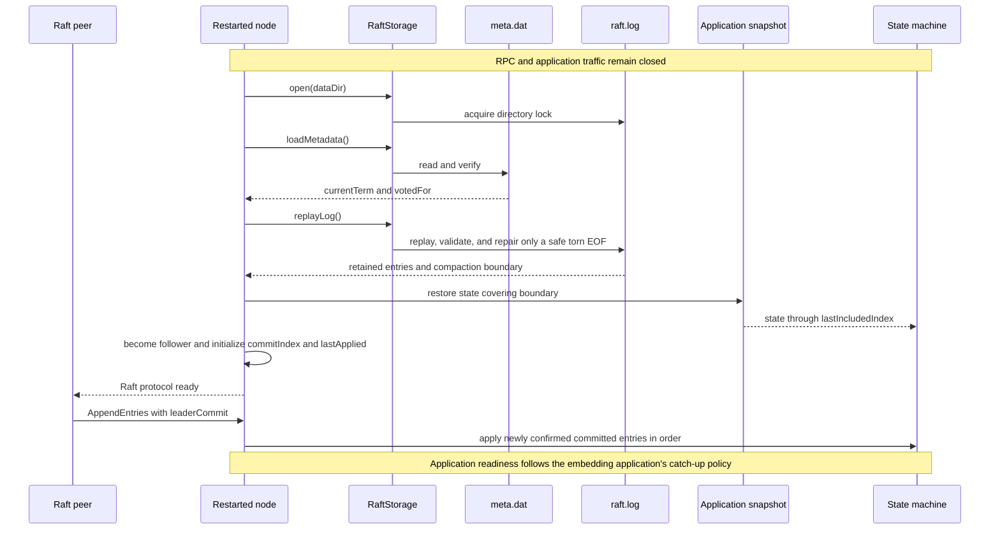
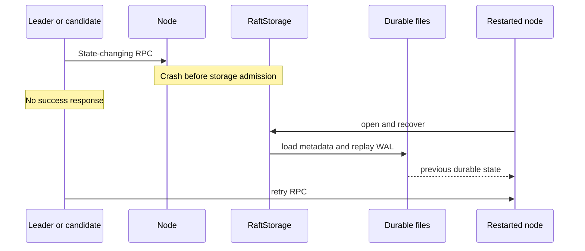
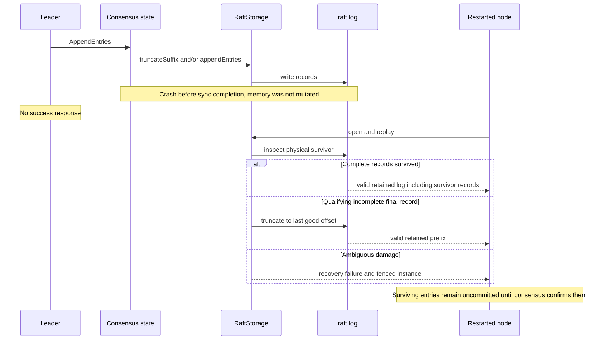
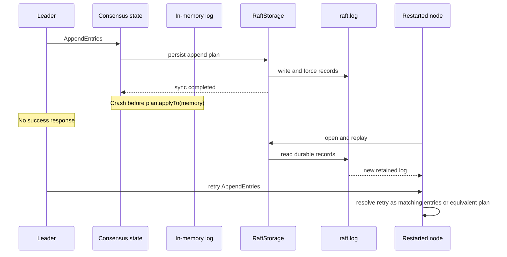
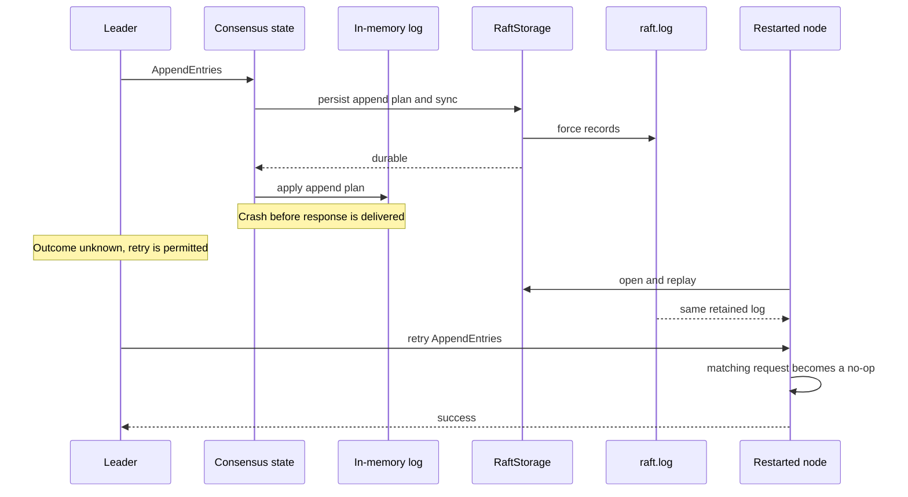
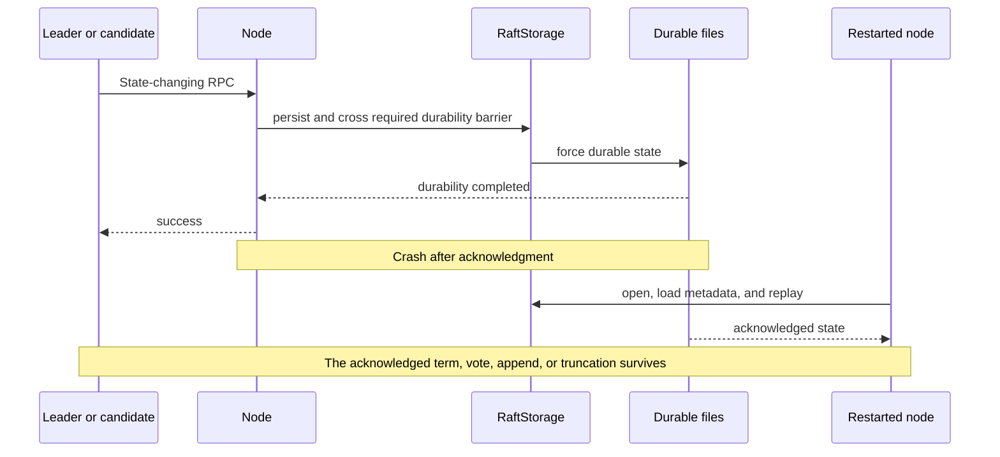
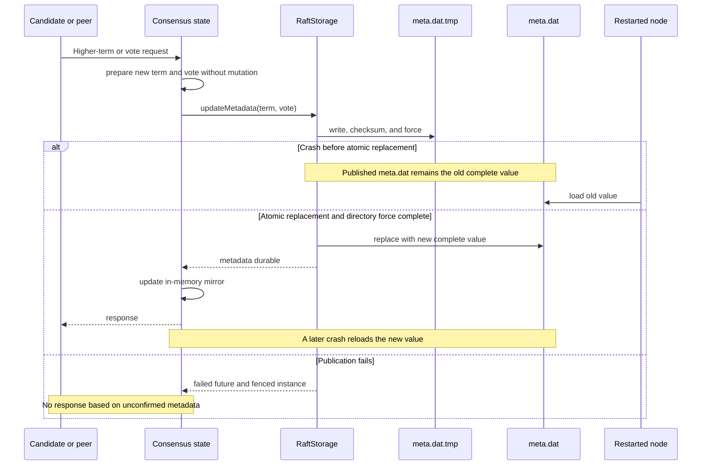
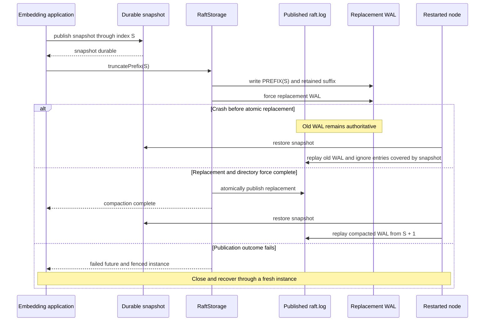
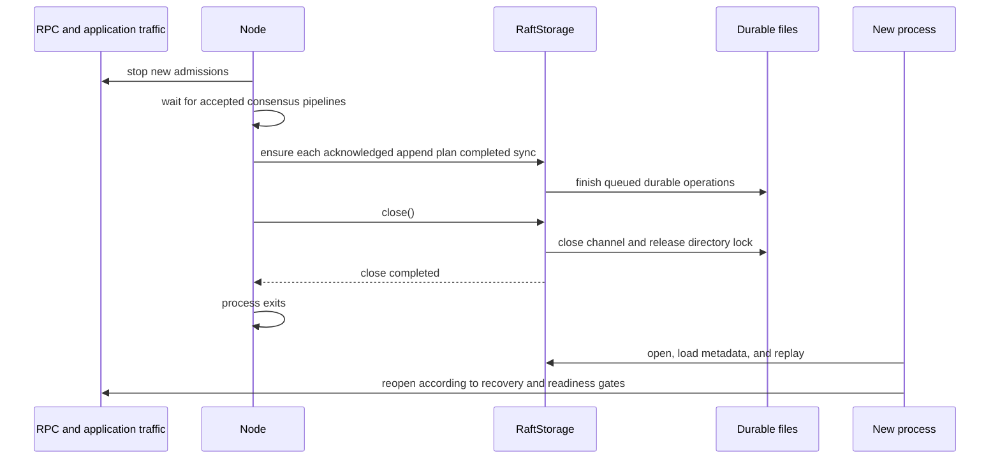
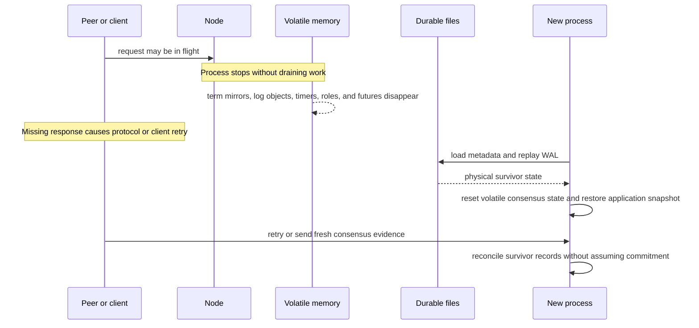

# Minimal Write-Ahead Log (WAL) for Raft
**Design, Requirements, and Integration Strategy**

| Document metadata | Details |
| --- | --- |
| Author | Mark Andrew Ray-Smith, Cityline Ltd |
| Status | Maintained architecture and design specification |
| Last updated | 2026-10-11 |
| Applies to | RaftLog 1.4.1 |

## Introduction

### What RaftLog is

RaftLog is a small Java library that provides the persistence layer for a Raft consensus implementation. It stores the three pieces of state that the Raft protocol requires a server to keep on stable storage, `currentTerm`, `votedFor` and the replicated log, and it guarantees that once it reports an operation complete, that state will survive a process crash and, subject to the filesystem's own guarantees, a power loss.

It is published as `io.github.mraysmit:raftlog-core`, requires Java 25, is licensed under Apache 2.0, and has no framework dependency. A single class, `FileRaftStorage`, implements a single interface, `RaftStorage`, on top of two files in a directory. The whole library can be read in an afternoon, and that is deliberate.

### Background

Raft is widely used for leader election and for replicating small amounts of critical state, such as cluster metadata, configuration and coordination records. Implementations of the algorithm itself are common. Implementations that persist state correctly are much rarer, because the Raft paper specifies what must be on stable storage but leaves the mechanics to the implementer, and the mechanics are where the difficulty lies.

A Raft implementation that keeps its term, its vote and its log in memory will elect leaders and replicate entries correctly while every node stays up, and will fail the moment one restarts: the restarted node forgets which term it is in and whom it voted for, can vote a second time in the same term, and can acknowledge entries that it no longer holds. These are not defects in the algorithm. They are the consequence of skipping the persistence contract the algorithm depends on.

RaftLog is that contract, implemented once, as a library with no dependency on any particular application or framework, so that a consensus layer can adopt it without adopting anything else.

### The problem it solves

Raft's safety argument depends on a simple promise: when a server tells its leader that it has stored an entry, or tells a candidate that it has granted a vote, that fact must still be true after the server crashes and restarts. The paper lists `currentTerm`, `votedFor` and the log as "persistent state" and requires them to be "updated on stable storage before responding to RPCs."

Meeting that promise on a real operating system is harder than it looks:

- A successful `write()` puts data in the page cache, not on disk. Only `fsync` moves it to stable storage, and a reply sent before `fsync` returns is a lie.
- A crash can tear a write, leaving a record half on disk. The log must be able to tell a torn tail from a clean one, and must never mistake corruption inside acknowledged data for a torn tail.
- Renaming a file into place is atomic, but on Linux the rename is not durable until the parent directory is fsync'd as well.
- A failed `fsync` leaves the page cache in an undefined state. Retrying it can succeed while the data is gone.
- When a follower's log conflicts with the leader's, the conflicting suffix must be deleted and replaced, and a crash in the middle of that sequence must leave a log that replays to a consistent prefix.

RaftLog exists to get each of these right once, in one place, with tests that exercise the real filesystem, so that the consensus layer above it does not have to.

### What the library provides

- A `RaftStorage` interface with six operations: `open`, `updateMetadata`, `loadMetadata`, `appendEntries`, `truncateSuffix`, `sync`, plus `replayLog` for startup and `truncatePrefix` for compaction.
- `FileRaftStorage`, which implements it with an append-only `raft.log` of CRC32C-checksummed records and an atomically replaced `meta.dat`.
- A single-writer discipline enforced by an executor the storage owns, so callers cannot accidentally interleave writes.
- Startup replay that reconstructs the logical log from the physical record sequence, resolving truncation markers in order and repairing structurally incomplete EOF writes.
- `AppendPlan`, a pure calculator that turns an incoming `AppendEntries` batch into the exact truncate-and-append sequence the WAL needs, so the "persist first, then mutate memory" rule is easy to follow and hard to get wrong.
- Explicit prefix compaction that rewrites the WAL to drop entries covered by an application snapshot the caller has already made durable.
- A lock file, a free-space check and an optional read-after-write verification mode.

### What the library deliberately does not do

RaftLog is the storage layer only. It does not implement leader election, log replication, membership changes, the `InstallSnapshot` RPC or a state machine. Those belong to the consensus implementation that embeds it. It does not own application snapshots: it will remove a prefix of the log when told to, but only the application knows when a snapshot is durable and what its last included index is.

It also does not try to be a database. There is one log file, no segments, no index, no random reads, no background compaction, no key-value semantics and no configuration that trades durability for speed in production. Section 13 sets out each of these non-goals and the reasoning behind it. They are the reason the library is small enough to verify.

### Who it is for and how it is used

The intended user is someone writing or maintaining a Raft implementation in Java who wants the persistence contract handled correctly without adopting a full consensus framework or an embedded database. The integration pattern is the same for every operation:

1. Compute what must change, without touching in-memory state.
2. Ask the storage to persist it, ending with the durability barrier: `sync()` for log operations, or the operation's own completion for metadata and compaction.
3. Only when that completes, mutate the in-memory log and reply to the RPC.

Sections 16 and 19.11 and Appendix E show this pattern applied to `AppendEntries`, `RequestVote`, the state-machine applier and startup recovery.

### Design principles

- **Persist before responding.** Every acknowledgement is preceded by a durability barrier. There is no configuration that removes it outside of test mode, and test mode logs a warning on startup.
- **Correctness over throughput.** Per-entry framing, per-record checksums, a single writer and a full `fsync` per barrier. Throughput comes from batching entries per barrier, never from weakening the barrier.
- **Minimal surface.** Two files, two record types, one interface. Anything that would make the library a general-purpose store is out of scope.
- **Fail loudly, never guess.** A durability failure fences the instance. Corruption inside acknowledged data is reported with its offset and left in place for the operator, not silently truncated.
- **The caller owns its state.** The library stores what it is given, keeps indexes and terms exactly as supplied, and never infers the application's snapshot boundary.

### How to read this document

Read sections 1 to 8 for the requirements and the record model, 13 for the non-goals, 14 to 16 for the interface and the integration pattern, and 19 for the review findings and their resolution. The appendices are reference material for platform behaviour, crash testing, configuration and deployment. The companion documents cover the [test suite](RAFTLOG_TEST_DOCUMENTATION.md) and the [release process](RAFTLOG_MAVEN_RELEASE_GUIDE.md).

## Scope
This document defines a **minimal, Raft-correct Write-Ahead Log (WAL)** design for a Java Raft implementation.

The WAL is intentionally constrained to support **only**:
- append
- truncate (suffix deletion)
- explicit prefix compaction after durable application snapshots
- sequential replay on startup

It is **not** a general-purpose storage engine.

---

## 1. Motivation

Quite often we see Raft implementations storing the following **entirely in memory**:

- `currentTerm`
- `votedFor`
- the Raft log (`List<LogEntry>`)

This violates Raft’s persistence requirements.

### Consequences of the this type of design
- Node restart resets `currentTerm` and `votedFor` → double voting, split elections
- Followers can acknowledge log entries that are lost on crash
- Log divergence and data loss become possible

In short: **this implementation design is unsafe under restart or crash**.

---

## 2. Raft Persistence Rules (Non-Negotiable)

Per the classic Raft paper, the following **must be durably persisted**:

### Persistent State
- `currentTerm`
- `votedFor`
- log entries

### Critical Rule
> **Persist-before-response**  
> A node must not respond positively to `RequestVote` or `AppendEntries` until the corresponding state is durably stored.

Durability means: **written to disk and fsync’d**.

### Invariants the storage enforces

The persistent state is only useful if it is a *well-formed* Raft state, so the
storage checks the following before it writes anything and refuses violations with a
`WriteRejectedException` carrying a `WriteRejectionReason`:

| Operation | Rule | Reason |
|-----------|------|--------|
| `appendEntries` | First index equals the next index after the tail; batch indices contiguous; indices start at 1 | `INDEX_NOT_CONTIGUOUS` |
| `appendEntries` | Terms non-decreasing within the batch and against the last entry | `TERM_REGRESSION` |
| `truncateSuffix` | Boundary at least 1 and no greater than next index (exactly at the tail is a no-op) | `INVALID_TRUNCATION` |
| `updateMetadata` | Term not below the persisted term | `TERM_REGRESSION` |
| `updateMetadata` | Vote in the persisted term not changed once cast | `VOTE_CHANGED` |
| any write | A non-empty log has been replayed since open, and no write has failed since | `LOG_STATE_UNKNOWN` |
| `updateMetadata` | `meta.dat` is absent or readable; an unreadable file hides a term the node may have voted in | `METADATA_UNREADABLE` |

Replay applies the same shape check to the reconstructed log and fails on a gap, a
term regression, or a first entry that does not follow the compaction boundary. The
tail state is owned by the WAL executor and is established by `open()` on an empty file
(next index 1), by `replayLog()`, and by `truncatePrefix()`. Compaction persists its
boundary as a `PREFIX` record at the head of the rewritten WAL, so after a restart the
log continues at the boundary plus one even when nothing was retained, and a suffix
truncation cannot reach into the compacted prefix.

Two properties keep these checks honest:

- **The write path and the replay path agree.** Anything accepted at write time must
  replay after a restart, and anything replay would refuse must be refused at write
  time. To make that possible the storage remembers the term of every retained entry
  as a short list of term runs (one element per term change), so a suffix truncation
  restores the term of the new last entry instead of forgetting it.
- **A refused operation writes nothing, and a failed one is never trusted.** Validation
  and the disk space check run for the whole batch before the first byte. If a write
  fails part way for any reason, checked or unchecked, the tail is marked unknown and
  the next write is refused until `replayLog()` has re-read the file.

The tail is tracked as the last index rather than the next one, so no comparison ever
computes `Long.MAX_VALUE + 1`. A log whose last index is `Long.MAX_VALUE` is full.

Two records are never repaired even when structurally incomplete. A torn `PREFIX` marker is reported as corruption, because compaction publishes it atomically after a force, so a crash cannot tear it, and truncating it away would silently restart the index space at 1. A fragment that declares a newer format or an unknown type is likewise reported, since this build cannot know how long such a record is. A `TRUNCATE` record with a boundary at or below the compaction boundary is never written, because the write path refuses it, but replay may meet one in an existing log. It empties the replayed log back to that boundary.

A read that ends early inside the known length of the file means the file is changing while replay reads it. Nothing can be concluded about its contents, so it is reported as an I/O failure: no corruption verdict, no fence, and no truncation. It must never be read as "structurally incomplete", because that verdict is what authorises repair.

A compacted log may carry no `PREFIX` marker, in which case it simply begins above index 1. Replay infers the boundary from the first entry: a log that starts at N was compacted through N - 1. That range is protected from suffix truncation and rewriting exactly as if the marker were present, and the next compaction writes the marker.

The configured payload limit governs what may be written, never what can be read. A record being read is bounded by the file that holds it, and its CRC decides whether it is genuine, so lowering the limit cannot make entries already in the log unreadable. The limit remains a plausibility check on torn writes: a fragment that declares more than this build would ever write was not torn by a crash, and is reported rather than repaired.

`AppendPlan` holds its arguments to the same rules as the storage and throws on any inconsistency, including two entries with the same index and term but different payloads. Every sample in this document that calls `AppendPlan.from` passes the compaction boundary, which is 0 for a log that has never been compacted and otherwise comes from `RaftStorage.compactionBoundary()`.

Refusal, not repair, is deliberate. Concurrent appenders, a leader that resends an
index without truncating first, or a node that regresses its term are all bugs. The
storage reports them at the call site rather than recording a log that replays into
something the AppendEntries algorithm cannot interpret.

---

## 3. Design Constraints & Assumptions

This WAL is designed around the following assumptions:

- The Raft log is kept fully **in memory during runtime**
- Disk is only used for:
  - crash recovery
  - restart replay
- No random disk reads are required during steady state
- Application snapshots remain caller-owned; prefix compaction is explicit
- Correctness is prioritised over throughput

These constraints significantly simplify the WAL design.

---

## 4. High-Level Architecture

### Files
```
data/
 ├─ meta.dat     // currentTerm + votedFor
 └─ raft.log     // append-only WAL
```

### Responsibilities
- `meta.dat`
  - Stores `(currentTerm, votedFor)`
  - Atomically rewritten on update
- `raft.log`
  - Append-only
  - Stores both truncation markers and appended log entries
  - Sequentially replayed on startup

---

## 5. WAL Record Model

Only **two record types** are required.

```
RecordType:
  - TRUNCATE
  - APPEND
```

### Record Format (binary)
Each record is self-framing and checksummed:

| Field            | Type   |
|------------------|--------|
| Magic            | int    |
| Version          | short  |
| Record Type      | byte   |
| Log Index        | long   |
| Term             | long   |
| Payload Length   | int    |
| Payload Bytes    | byte[] |
| CRC32C           | int    |

---

## 6. AppendEntries Integration (Critical Path)

Correct sequence per AppendEntries RPC:

1. Validate `prevLogIndex / prevLogTerm`
2. Write WAL records:
   - `TRUNCATE(conflictIndex)` if required
   - `APPEND(index, term, payload)` for each new entry
3. `fsync()` once after all records are written
4. Apply the same truncate + append to in-memory log
5. Reply `success = true`

---

## 7. RequestVote Integration

When granting a vote, or when observing a higher term even if the vote is rejected:

1. Compute the new `(currentTerm, votedFor)` without mutating memory.
2. Persist both **together** in `meta.dat`.
3. Wait for the metadata durability barrier.
4. Update the in-memory mirror.
5. Send the grant or rejection response.

Persisting a higher term is required even when no vote is granted. A crash must not allow the node to return to an older term.

---

## 8. Startup Replay

All ordinary in-memory state disappears on a process crash, forced termination, or restart. Recovery does not serialize the old Java objects; it constructs new state from durable facts.

### 8.1 State ownership across a restart

| State | Survives through | Restart rule |
|---|---|---|
| `currentTerm`, `votedFor` | `meta.dat` | Load before processing any Raft RPC. The in-memory fields are mirrors of this durable value. |
| Retained log entries | `raft.log` | Rebuild by replaying records in order. Never reconstruct indexes from list positions. |
| Prefix compaction boundary | `PREFIX` record, or the first retained format-1 entry | Read after replay and require an application snapshot that covers it. |
| `role`, known leader, election timer, active election | Nothing | Reset to follower/no known leader and start fresh timers after recovery. A process never restarts as leader merely because it was leader before the crash. |
| `commitIndex` | Not stored by RaftLog | Initialize to the restored snapshot's `lastIncludedIndex`, or 0 with no snapshot. Advance only from fresh consensus evidence such as `leaderCommit` or a leader's majority replication calculation. |
| `lastApplied` | Application snapshot or durable application state | Initialize to the restored application's applied index, normally the snapshot's `lastIncludedIndex`, then advance through the serialized application chain. |
| Leader `nextIndex` and `matchIndex` | Nothing | Reinitialize if this node later wins an election. |
| Pending RPCs, client futures, callbacks | Nothing | Fail with the process. Senders retry; application-level request identifiers provide deduplication where required. |
| Application state machine | Application-owned durable snapshot/state | Restore independently, then apply only WAL entries known to be committed and newer than the restored boundary. |

The WAL proves which log entries the node possesses. It does **not** prove that every retained entry is committed. An uncommitted suffix is expected Raft state and must not be applied merely because replay found it.

### 8.2 Restart sequence and readiness gates

1. Keep Raft RPC handling and application traffic closed.
2. Open the storage directory and acquire its exclusive lock.
3. Load `meta.dat` to recover `currentTerm` and `votedFor`.
4. Replay `raft.log`, safely repair only a qualifying incomplete EOF record, and recover the retained log and compaction boundary.
5. Restore an application snapshot or durable state whose applied index covers the compaction boundary. If no snapshot exists, the boundary must be 0 and the application starts empty.
6. Initialize the node as a follower with no known leader. Set `commitIndex` and `lastApplied` to the restored application's applied boundary, not to the last WAL index.
7. Open Raft protocol handling. A leader's `leaderCommit`, or a newly elected leader's majority evidence, establishes which retained suffix entries may be applied.
8. Open application reads and writes only when the embedding application’s catch-up and leadership/read-consistency policy says the node is ready.

Replay is mandatory. `open()` seeds the metadata baseline, but the log tail is known only after `replayLog()`. Until then, an append or suffix truncation on a non-empty log is refused with `LOG_STATE_UNKNOWN`. A write failure also makes the tail unknown, so the same instance must replay before another write can be considered.

### 8.3 Crash timing at a persistence boundary

| Crash point | Possible durable result after restart | Required behavior |
|---|---|---|
| Before a storage operation is accepted | Previous durable state | Nothing was acknowledged or changed. |
| After WAL bytes are written but before `sync()` completes | Previous state, the complete new records, or a safely repairable incomplete final record | No success response was sent and memory was not mutated. Replay decides what physically survived; any surviving suffix remains uncommitted until consensus confirms it. |
| After `sync()` completes but before memory mutation | New WAL state | The old memory disappears in the crash. Replay reconstructs the new state; a retried AppendEntries request must be idempotent. |
| After memory mutation but before the response is delivered | New WAL state | The sender may retry because it saw no response. The retry must resolve to a no-op or the same safe plan. |
| After a success response | New WAL state | This is the promised durability boundary: acknowledged term, vote, append, or truncation survives restart, subject to filesystem guarantees. |
| During metadata publication | Either the old complete `meta.dat` or the new complete `meta.dat` | Atomic replacement prevents a partially published metadata value. Failure fences the instance and no grant or higher-term response is sent from an unconfirmed state. |
| During prefix compaction | Either the previous WAL or the durably published compacted WAL | The caller's snapshot was durable first, so either WAL generation is recoverable. A publication failure fences the instance. |

A complete bad CRC, malformed header, unexplained garbage, missing snapshot for a compacted boundary, or unreadable metadata is not treated as “memory was lost.” It is a recovery failure. The node remains unavailable and is repaired from a healthy peer rather than inventing empty state.

### 8.4 Graceful restart versus crash

A graceful restart first stops new admissions, waits for every accepted consensus persistence pipeline to finish, and then closes storage so the channel and directory lock are released. `close()` is a resource-release barrier; it does not replace the `sync()` required by an append/truncation pipeline.

A crash provides none of those orderly steps. The safety result is nevertheless the same at the protocol boundary: anything positively acknowledged was already durable, while anything not acknowledged may or may not appear after replay and must be reconciled by Raft.

### 8.5 Crash and restart sequence diagrams

The diagrams use the same rule throughout: durable storage is authoritative after restart, while volatile memory is discarded and reconstructed. A missing response means the sender may retry.

#### Normal restart recovery



#### Crash before the storage operation is accepted



#### Crash after WAL bytes are written but before `sync()` completes



#### Crash after `sync()` but before in-memory mutation



#### Crash after in-memory mutation but before response delivery



#### Crash after a success response



#### Crash during metadata publication



#### Crash during prefix compaction



#### Graceful restart



#### Abrupt crash and restart



---

## 9. Async Integration Model

- WAL operations are blocking
- Run on a dedicated single-thread executor owned by the storage
- Raft logic remains on the caller's own thread; storage returns `CompletableFuture`s

---

## 10. Testing Requirements

Mandatory tests:

- Crash during append
- Crash during truncate
- Vote persistence across restart
- CRC corruption detection

---

## 11. Effort Estimate

Total estimated effort: **~2 weeks**

---

## 12. Conclusion

This WAL design is minimal, correct, and well-scoped. It avoids unnecessary complexity while meeting Raft’s safety requirements.

---

## 13. Explicit Non-Goals (Hard Constraints)

To avoid scope creep and accidental re-implementation of a database, the following are **explicit non-goals** of this WAL:

- ❌ No random-access reads from disk during runtime
- ❌ No log segments or segment rotation (initially)
- ❌ No background compaction
- ❌ No snapshots (initially)
- ❌ No key/value semantics
- ❌ No concurrent writers
- ❌ No read-after-write guarantees beyond in-memory state
- ❌ No attempt to make the WAL "fast" by weakening durability rules

The WAL exists **solely** to:
- survive crashes
- enforce Raft safety rules
- rebuild in-memory state on restart

Anything beyond that is out of scope.

### 13.1 No Random-Access Reads from Disk

**What this means:** During normal runtime, the WAL is **write-only**. The system never seeks to a specific position to read a particular entry. All log entries are served from the in-memory `List<LogEntry>`.

**Why it's a non-goal:** Random-access reads require an **index** (entry index → file offset mapping). Building and maintaining an index:
- Adds complexity (index corruption, index-vs-data consistency)
- Requires additional disk I/O (index file reads)
- Is unnecessary when the entire log fits in memory

**Trade-off:** The entire Raft log must fit in memory. For the expected workload of a metadata-oriented application (small commands, not bulk data), this is acceptable.If you had millions of entries, you'd need segments + index.

**If you need this later:** Add a separate index file that maps `logIndex → fileOffset`, written during append and read during recovery to enable random access.

### 13.2 No Log Segments or Segment Rotation

**What this means:** There is **one WAL file**, `raft.log`, which grows between explicit prefix compactions. We don't split the log into multiple segment files (e.g., `segment-0001.wal`, `segment-0002.wal`).

**Why it's a non-goal (initially):** Segmentation adds significant complexity:
- Deciding when to rotate (size-based? entry-count-based? time-based?)
- Managing the "active" vs "sealed" segment distinction
- Handling recovery across multiple files
- Coordinating segment deletion after snapshots

A single file simplifies everything.

**Current behavior:** File size grows unless the caller durably snapshots and invokes `truncatePrefix`. The library does not schedule compaction automatically.

**If you need this later:** Implement segment rotation when the current segment exceeds a size threshold (e.g., 64MB), seal the old segment, open a new one, and update recovery to scan all segments in order.

### 13.3 No Background Compaction

**What this means:** Unlike LSM-tree databases (RocksDB, LevelDB), we don't run background threads merging or compacting data files.

**Why it's a non-goal:** Raft log entries are **immutable and ordered**. There's nothing to "compact" in the traditional sense. Compaction in databases removes obsolete key versions—Raft entries don't have versions, they're an append-only sequence.

**Trade-off:** None for correctness. This is simply not applicable to WAL semantics.

**If you need this later:** You don't. What you need instead is **snapshots** (see 13.4) to truncate prefix entries that have been applied to the state machine.

### 13.4 No Snapshots (Initially)

**Current behavior:** The caller checkpoints its state machine durably, then invokes `truncatePrefix`. RaftLog does not own or create the application snapshot.

**Why it's a non-goal (initially):** Snapshots are complex:
- Must capture a consistent state machine image
- Must track the "last included index/term" for Raft protocol correctness
- Must handle InstallSnapshot RPC for slow followers
- Must coordinate snapshot creation with ongoing operations

This is significant implementation effort that can be deferred.

**Current integration requirement:** Publish a durable application snapshot before explicit prefix compaction; without it the WAL continues to grow.

**Current API:** The application persists its snapshot and boundary metadata, then calls `truncatePrefix(lastIncludedIndex)`. Snapshot creation is not a RaftLog API.

### 13.5 No Key/Value Semantics

**What this means:** The WAL treats every entry as an **opaque byte array**. It has no understanding of keys, values, columns, or any schema. It doesn't support "get entry by key" or "delete key".

**Why it's a non-goal:** The WAL's job is to persist the **Raft log**, which is a sequence of commands. The interpretation of those commands belongs to the **state machine**, not the storage layer.

**Trade-off:** The WAL cannot answer queries like "what's the latest value for key X?" — that's the state machine's responsibility.

**If you need this later:** You don't want it in the WAL. You want a state machine that maintains key/value state by processing log entries.

### 13.6 No Concurrent Writers

**What this means:** Exactly **one thread** (the `walExecutor`) performs all write operations. There's no support for multiple threads appending simultaneously.

**Why it's a non-goal:** Raft has a **single leader** at any term. Only the leader appends entries. Even on a single node, the Raft algorithm is sequential—there's no benefit to concurrent writes.

**Trade-off:** Write throughput is limited to single-threaded performance. For Raft metadata operations, this is more than sufficient.

**If you need this later:** You don't for Raft. If you somehow need parallel writes, you're probably building something other than a Raft log.

**What happens if you do it anyway:** the executor still serializes the bytes, and the
invariant checks refuse every append that does not continue the tail. Racing appenders
therefore get a stream of `INDEX_NOT_CONTIGUOUS` rejections and a contiguous log, never
a reordered or interleaved one. The chaos suite's writer storm demonstrates exactly this.

### 13.7 No Read-After-Write Guarantees Beyond In-Memory State

**What this means:** After you call `appendEntries()`, you can immediately read those entries—from the **in-memory log**. There's no guarantee you can read them **from disk** until recovery.

**Why it's a non-goal:** During normal operation, all reads go to memory. The WAL is purely a durability mechanism. The only time we read from the WAL file is during recovery at startup.

**Trade-off:** You cannot implement "read entry X from disk" during runtime. All reads must go through the in-memory `List<LogEntry>`.

**If you need this later:** This pattern is actually correct for WAL design. If you need disk-based reads during runtime, you're building a database, not a WAL.

### 13.8 No Durability Weakening for Performance

**What this means:** We will **not** implement "optimizations" that trade durability for speed:
- No `fsync` batching across unrelated operations
- No periodic `fsync` instead of per-operation
- No reliance on OS write-back caching
- No `fdatasync` (we use `fsync` which also syncs metadata)

### 13.9 Prefix Compaction Implementation Notes

RaftLog uses explicit, caller-driven prefix compaction. It is safe only when the application has durably published a snapshot boundary (`lastIncludedIndex`/`lastIncludedTerm`) and can guarantee those boundary values are correct for its own state machine.

The compaction flow is:
- Caller takes durable snapshot
- Caller calls `truncatePrefix(lastIncludedIndex).thenAccept(...)`
- WAL materializes retained entries and replaces `raft.log` atomically

Implementation details:
- No segment files are used; compaction is implemented by rewriting `raft.log` via `raft.log.tmp`.
- The WAL executor serializes compaction with append, suffix truncation, metadata, replay and sync.
- A PREFIX record carrying the inclusive boundary is written first, then the retained APPEND records, then the temp file is forced and atomically moved into place.
- Directory force is attempted after replacement on non-Windows providers.
- `truncatePrefix` is idempotent; zero is a no-op and negative indices are rejected.

Failure and recovery semantics:
- If publication does not complete, the previous `raft.log` remains authoritative.
- Once publication enters uncertainty (failed force/rename/reopen), the instance is fenced and must be replaced with a fresh open instance.
- On open, stale temp files are handled safely; a temp without authoritative `raft.log` causes open to fail rather than invent an empty log.
- Structurally incomplete source log tails must be repaired with `replayLog()` before compaction.
- Complete malformed records, bad CRCs, arbitrary garbage and corruption followed by valid records report `CorruptLogException` and are not silently truncated.

Platform caveat:
- Windows file-provider behavior does not support directory fsync in this implementation; compaction forces file content and relies on atomic replace, but cannot claim full power-loss durability guarantees for the same durability level as non-Windows providers.

**Why it's a non-goal:** Raft safety requires that once we respond to an RPC, the data **must** be durable. Any "optimization" that violates this breaks Raft's correctness guarantees.

**Acceptable optimizations:**
- Batching multiple entries in a single `appendEntries()` call (with one `fsync` at the end)
- Using memory-mapped files (still with explicit `msync`)
- Using kernel AIO with synchronous completion notification

**Unacceptable optimizations:**
- Responding before `fsync` completes
- Using `O_DIRECT` without explicit `fsync`
- Disabling `fsync` for "testing" and forgetting to re-enable

**Trade-off:** Writes are as slow as `fsync` allows (typically 1-10ms on SSD). For Raft consensus operations, this is acceptable. High-throughput systems should batch multiple entries per append.

**If you need this later:** The only safe path is batching—accumulating multiple entries and syncing once. Never skip or defer `fsync`.

---

## 14. Generic Raft Storage Interface (`RaftStorage`)

To ensure the system can switch between a **Custom WAL** (simple, pure Java) and **RocksDB** (high performance, key-value), we define a backend-agnostic interface. The `RaftNode` will depend solely on this interface.

### Why this exists

- The Raft consensus layer needs one abstraction for persistence, with one durability model.
- The abstraction decouples protocol logic from concrete storage details (append-only file vs RocksDB).
- It isolates where durability rules are applied and where replay/rebuild invariants are enforced.

### Authoritative interface

The complete, current contract is [`RaftStorage.java`](../raftlog-core/src/main/java/dev/mars/raftlog/storage/RaftStorage.java). It defines metadata durability, append and suffix-truncation barriers, prefix compaction, replay, lifecycle behavior, and the value objects exchanged with an embedding consensus layer.

The contract that integrations must preserve is:

- `updateMetadata` is durable when its future completes.
- `appendEntries` and `truncateSuffix` are not durable until a following `sync` completes.
- `truncatePrefix` is its own durability barrier and may only follow publication of a covering application snapshot.
- A non-empty WAL must be replayed after open before accepting writes.
- A failed write or force may fence the instance; callers close it and recover through a fresh instance.
- `close` releases the channel and directory lock before returning; `closeAsync` provides non-blocking observation.

This document uses shortened integration pseudocode below. It intentionally does not duplicate the Java interface, because the source contract evolves with the implementation.
### 14.1 Plug-in Implementations

| Feature | **FileRaftStorage** (Custom WAL) | **RocksDbRaftStorage** (Adapter) |
| :--- | :--- | :--- |
| **Metadata** | Atomic rename of `meta.dat` | `batch.put("meta:term", ...)` |
| **Append** | `FileChannel.write()` (append-only) | `batch.put("log:<index>", ...)` |
| **Truncate** | `FileChannel.truncate()` | `db.deleteRange("log:<index>", "log:MAX")` |
| **Sync** | `FileChannel.force(false)` | `db.write(batch, {sync: true})` |
| **Replay** | Sequential read + CRC check | Iterator scan over `log:*` prefix |

---

## 15. Implementation A: FileRaftStorage (The Custom WAL)

This is the default implementation (zero dependencies beyond SLF4J).

This section describes a minimal, crash-safe implementation using `FileChannel`.

### 15.1 Files
```
data/
 ├─ meta.dat       // currentTerm + votedFor (atomic replace)
 └─ raft.log       // append-only WAL: TRUNCATE and APPEND records
```

### 15.2 Record framing (raft.log)

A simple, robust binary record:

| Field | Type |
|------|------|
| MAGIC | int |
| VERSION | short |
| TYPE | byte | 
| INDEX | long |
| TERM | long |
| PAYLOAD_LEN | int |
| PAYLOAD | byte[] |
| CRC32C | int |

- **CRC32C** covers all bytes from `MAGIC` through `PAYLOAD`.
- On replay, stop at the first:
  - incomplete record
  - CRC mismatch
- Then truncate `raft.log` to the last known-good byte offset.

### 15.3 Types

```java
static final byte TYPE_TRUNCATE = 1;
static final byte TYPE_APPEND   = 2;
static final byte TYPE_PREFIX   = 3; // compaction boundary; first record of a compacted WAL, INDEX = inclusive boundary
// VERSION is 1 for APPEND and TRUNCATE and 2 for PREFIX. An intact record with a higher version
// is reported as UnsupportedFormatException, not corruption, and fences the instance.
```

### 15.4 meta.dat (term + vote)
`meta.dat` must be updated atomically. The simplest safe method:

1. write new bytes to `meta.dat.tmp`
2. `force(true)` the tmp file
3. atomic move/rename `meta.dat.tmp` → `meta.dat`
4. fsync the directory (optional but recommended on Linux for maximum safety)

This avoids partial meta overwrites.

### 15.5 Async offload + serialization model
- `FileChannel` I/O is blocking → run on a **dedicated single-thread executor**
- Enforce a **single-writer** discipline:
  - either a one-thread executor owned by the storage (the shipped approach), or
  - internal queue (actor style)

### 15.6 Authoritative implementation

The production implementation is maintained in these source files:

- [`FileRaftStorage.java`](../raftlog-core/src/main/java/dev/mars/raftlog/storage/FileRaftStorage.java) — lifecycle, metadata publication, record encoding, replay, fencing, validation, and compaction.
- [`CompactionIo.java`](../raftlog-core/src/main/java/dev/mars/raftlog/storage/CompactionIo.java) — filesystem operations and the test seams around them.
- [`RaftStorageConfig.java`](../raftlog-core/src/main/java/dev/mars/raftlog/storage/RaftStorageConfig.java) — configuration resolution and validation.
- [`FileRaftStorageRecoveryContractTest.java`](../raftlog-core/src/test/java/dev/mars/raftlog/storage/FileRaftStorageRecoveryContractTest.java) — executable recovery and evidence-preservation contract.
- [`FileRaftStorageInvariantEdgeCaseTest.java`](../raftlog-core/src/test/java/dev/mars/raftlog/storage/FileRaftStorageInvariantEdgeCaseTest.java) — executable index, term, metadata, and lifecycle edge cases.

These files are authoritative. In particular, replay repairs only a structurally incomplete and plausibly next EOF record. Complete corruption is preserved, reported, and used to fence the instance; it is never reduced to the older rule “stop and truncate at any bad record.”
## 16. Wiring Persistence and Application into RaftNode

This section defines how the `RaftStorage` and `AppendPlan` interact with the `RaftNode` state machine, mapping directly to:

- `RaftNode.handleVoteRequest(VoteRequest request)`
- `RaftNode.handleAppendEntriesRequest(AppendEntriesRequest request)`

### 16.1 The AppendEntries Pipeline (Follower Side)

After validating the term and the previous-log index and term, prepare the change without mutating memory, serialize the WAL operations, cross one durability barrier, and only then update consensus-owned state and reply.

If the request advances the local term, persist the new term and cleared vote before continuing or responding. The embedding consensus implementation owns that sequencing.

**Integration pseudocode — intentionally incomplete and not directly compilable:**

```java
AppendPlan plan = AppendPlan.from(
    previousIndex + 1, incomingEntries, retainedLog, compactionBoundary);

CompletableFuture<Void> durable = persistHigherTermIfNeeded(requestTerm);
if (plan.truncateFromIndex() != null) {
    durable = durable.thenCompose(v -> storage.truncateSuffix(plan.truncateFromIndex()));
}
if (!plan.entriesToAppend().isEmpty()) {
    durable = durable.thenCompose(v -> storage.appendEntries(plan.entriesToAppend()));
}

durable.thenCompose(v -> storage.sync())
    .whenCompleteAsync((ignored, failure) -> {
        if (failure != null) {
            replyFailure(failure);
            return;
        }
        plan.applyTo(retainedLog);
        advanceCommitIndexFrom(requestLeaderCommit);
        replySuccess(lastRetainedIndex());
    }, consensusExecutor);
```

`lastRetainedIndex()` must use entry indexes or the compaction boundary, not `List.size()`. A compacted log need not begin at index 1.
### 16.2 RequestVote: Persist-before-Grant

A vote grant and any move to a higher term must be persisted before the node mutates its in-memory term/vote or sends a response. `updateMetadata` already includes its durability barrier; it must not be followed by a separate WAL `sync`.

**Integration pseudocode — intentionally incomplete and not directly compilable:**

```java
VoteDecision decision = prepareVoteDecision(request, currentTerm, votedFor, retainedLog);

storage.updateMetadata(decision.term(), decision.persistedVote())
    .whenCompleteAsync((ignored, failure) -> {
        if (failure != null) {
            failRequest(failure);
            return;
        }
        currentTerm = decision.term();
        votedFor = decision.persistedVote().orElse(null);
        replyVote(decision.granted(), currentTerm);
    }, consensusExecutor);
```

`prepareVoteDecision` is pure. It must also produce a metadata update when a higher-term request is rejected for another reason, because the higher term itself is persistent Raft state.
### 16.3 Why Persist-Before-In-Memory?

Because the follower's ACK must mean: "this change will survive restart."

Persist-first gives you a clean invariant:
- **If we ACK success, the WAL contains the truncation+append and has been fsync'd.**
- **If we grant a vote, the term and votedFor are durable before the response leaves.**

This is the **Durability Barrier** — the single most important correctness property of Raft persistence.

### 16.4 The State Machine Application Chain

Committed entries are applied one at a time. Do not start asynchronous work in a synchronous `while` loop: `lastApplied` does not advance until completion, so such a loop can submit the same entry repeatedly.

**Integration pseudocode — intentionally incomplete and not directly compilable:**

```java
CompletableFuture<Void> applyNextCommitted() {
    if (lastApplied >= commitIndex) return CompletableFuture.completedFuture(null);

    long index = lastApplied + 1;
    LogEntryData entry = retainedEntryAt(index);
    return stateMachine.execute(entry.payload())
        .thenComposeAsync(result -> {
            lastApplied = index;
            completeWaitingClient(index, result);
            return applyNextCommitted();
        }, consensusExecutor);
}
```

The embedding application must define snapshot restoration and the committed index used during recovery. Retained WAL entries are not automatically all committed.
### 16.5 Recovering `commitIndex`, `lastApplied`, and application state

RaftLog does not persist `commitIndex` or `lastApplied`. Neither value can be recovered from the WAL alone because the WAL may contain a valid uncommitted suffix.

On startup:

1. Restore the application snapshot or other durable application state.
2. Initialize `lastApplied` to the restored state's applied index.
3. Initialize `commitIndex` to the same boundary unless the embedding application has a stronger, separately durable consensus record.
4. Replay the WAL to reconstruct the entries the node possesses, without applying the suffix yet.
5. Learn or establish a newer commit boundary through Raft.
6. Apply entries from `lastApplied + 1` through `commitIndex`, sequentially.

With no snapshot, both volatile indexes begin at 0. With a snapshot through index `S`, both begin at `S`, and retained entries at or below `S` are already represented by the snapshot. A restarted node must not set either value to the final replayed WAL index simply because that entry exists.

If application commands can be observed outside the state machine, request identifiers or another application-level deduplication rule are still recommended. A crash can occur after durable application effects but before a waiting client receives its response.

---

## 17. Practical Integration Notes

- The storage owns a dedicated executor for WAL operations (pool size **1**, which simplifies ordering)
- WAL ops run via `CompletableFuture.runAsync(..., walExecutor)` inside the storage
- Never block the consensus thread; hop back to it with the `*Async(fn, executor)` variants before mutating in-memory state

---

## 18. Minimal Acceptance Criteria

Before considering the WAL "done":

- ✅ **Restart Safety:** `currentTerm` and `votedFor` are recovered before any RPC is handled
- ✅ **Commitment Safety:** Replay rebuilds possession only; no retained suffix entry is applied until a snapshot or fresh consensus evidence establishes that it is committed
- ✅ **Readiness Gate:** Application traffic stays closed until snapshot restoration, WAL replay, and the embedding application's catch-up policy are complete
- ✅ **Durability Barrier:** `AppendEntries` response is sent ONLY after `wal.sync()`
- ✅ **Application Order:** Entries are applied to the State Machine strictly in-order
- ✅ **Leader Consistency:** Leader only advances `commitIndex` after a majority `sync()` is confirmed
- ✅ **Replay Safety:** Replay truncates structurally incomplete EOF writes and preserves ambiguous corruption
- ✅ **Crash Test (Append):** Kill during append → restart yields prefix-safe log
- ✅ **Crash Test (Truncate+Append):** Kill during truncate+append sequence → replay yields a valid physical survivor state and loses no acknowledged entry

---
## 19. Design Review Feedback

**Review Date:** 2026-01-28

This section captures feedback from technical review of the WAL design.

---

### 19.0 Summary Verdict

> **This is a solid, Raft-correct, production-credible WAL design.**
> It is **minimal without being naive**, and—crucially—the **Raft safety invariants are explicit and enforced in wiring**, not hand-waved into comments.

If this landed in a design review with senior distributed-systems engineers, it would **pass with minor nits**, not fundamental objections.

---

### 19.1 What Was Done Correctly

#### ✅ Scope Discipline (This Is Rare)

The non-goals section (Section 13) is excellent. The design resists:
- Segmenting
- Snapshots
- Random reads
- Compaction fantasies

This is exactly how people successfully build WALs instead of accidentally rebuilding RocksDB badly. If someone later asks "can we just add X?", this document gives the authority to say **no**.

#### ✅ Persist-Before-Response Is Enforced, Not Described

The design doesn't just quote the Raft paper — it wires it:
- Vote is not granted until `meta.dat` is fsync'd
- AppendEntries is not ACK'd until `truncate + append + sync` completes
- In-memory state mutates **after** durability

That invariant is the entire game. This got it right.

#### ✅ Truncate as a Logical Record (Not Physical Truncate)

This is a good design choice for a minimal WAL.

Why it's correct:
- Physical truncation during runtime is risky
- Logical truncation + replay gives crash safety
- Final physical truncation happens only after replay

This is exactly how "real" systems do it.

#### ✅ Replay Semantics Are Correct

The replay loop:
- Stops on the first incomplete or corrupt record
- Applies truncates in sequence
- Rebuilds in-memory log deterministically
- Truncates only a structurally incomplete EOF fragment; ambiguous corruption is preserved and fenced

This is textbook WAL recovery logic.

#### ✅ Meta Handling Is Done Properly

All of the following are implemented correctly:
- Temp file write
- Fsync temp
- Atomic rename
- Fsync directory
- CRC verification

Most implementations miss at least one of these. This design doesn't.

---

### 19.2 Issues to Address

#### ❌ CRITICAL: `truncateSuffix()` Is Not Fsync-Isolated

Currently:

```java
truncateSuffix(long fromIndex) {
  return writeRecord(TYPE_TRUNCATE, ...);
}
```

But:
- `writeRecord()` does **not** force durability
- Durability is deferred to `sync()`

This is fine **only if** the RaftNode *always* batches truncate + append + sync as one atomic plan.

**Why this matters:**

Someone will eventually call:

```java
wal.truncateSuffix(x)
  .thenRun(...)
```

without a following `sync()`.

Now you have:
- Logical deletion recorded
- No durability barrier
- Possible reorder with later appends

**Fix (simple and worth it):**

Make the contract explicit in the interface:

```java
/**
 * Truncation is not durable until sync() is called.
 * Must not be called standalone in RaftNode.
 */
CompletableFuture<Void> truncateSuffix(long fromIndex);
```

And in `RaftNode`, enforce:
- Truncate + append **must** go through a single helper (`persistAppendPlan`)
- Never expose raw truncate calls

This is not a code bug yet — it's a **future foot-gun**.

#### ⚠️ FileChannel Positioning vs Concurrent Writes

The implementation relies on:

```java
logCh.position(logCh.size());
```

and then sequential writes.

Because the design enforces:
- Single writer
- Single worker executor

This is **currently safe**.

But document (or assert) that:
- No concurrent append paths exist
- No reopen occurs mid-flight

**Recommendation:** Add a comment or assertion:

```java
// Invariant: all writes are serialized via walExecutor (single thread)
```

Otherwise someone will "optimize" the executor size later and corrupt the log.

#### ⚠️ Replay Uses `READ, WRITE`

In replay:

```java
try (FileChannel ch = FileChannel.open(logPath, READ, WRITE)) {
```

`WRITE` is only needed for `truncate(lastGood)`.

This is acceptable, but be aware:
- Some filesystems behave differently for shared locks
- This implicitly allows replay to mutate while reading

**Note:** Replay **is destructive by design** — document this explicitly.

#### ⚠️ Payload Length Trust Boundary

The code does:

```java
int len = hdr.getInt();
if (len < 0 || len > (all.length - ...)) throw
```

Good — but in replay:

```java
ByteBuffer.allocate(len);
```

If the log is corrupted with a very large `len` (but CRC later fails), memory can still be exhausted.

**Mitigation (cheap):**
- Define a **max entry size** constant
- Reject `len > MAX_LOG_ENTRY_BYTES`

Raft entries are not unbounded in sane systems. `FileRaftStorage` bounds the payload length by `maxPayloadSizeMb` (default 16 MB) on both the append path and the replay path.

#### ⚠️ Interface Naming Consistency

Mixing names for the storage abstraction is a hazard: it is not a logic issue, but it causes conceptual drift ("is WAL different from storage?").

The rule is:
- Standardize on **one abstraction name**
- `RaftStorage` for the interface, `FileRaftStorage` for the file implementation

---

### 19.3 Architectural Recommendation

#### Introduce a Single Persistence Barrier Method in RaftNode

Instead of:

```java
wal.truncate(...)
wal.append(...)
wal.append(...)
wal.sync()
```

Encapsulate:

```java
wal.persist(AppendPlan plan)
```

Where:
- The storage implementation decides batching
- RaftNode cannot misuse the API
- RocksDB and File WAL stay symmetric

The design already conceptually has `AppendPlan`. Making it explicit reduces future mistakes.

---

### 19.4 Truncate-then-Append Ordering

**Concern:** If the node crashes after `TRUNCATE` is persisted but before `APPEND` completes, data may be deleted without replacement.

**Resolution:** The replay logic (Section 15.6) processes records sequentially and applies truncations as it goes. This is **correct** provided:
- The in-memory log is NOT updated until the entire batch (Truncate + all Appends) passes the `wal.sync()` barrier
- The "AppendPlan" approach in Section 16.2 enforces this correctly

---

### 19.5 CRC and Self-Framing

The record format is robust. Stopping at the first CRC mismatch or incomplete record is the standard approach for handling "torn writes" (OS crashes mid-write).

---

### 19.6 Directory Fsync (Critical on Linux)

The `meta.dat` atomic rename strategy is the "gold standard" for small metadata:

1. Write to `.tmp`
2. `fsync` the file
3. `rename` (atomic on POSIX)
4. **`fsync` the parent directory** ← Often overlooked but crucial

> **Important:** On Linux (ext4/xfs), fsyncing the directory ensures the directory entry itself (the pointer to the new inode) is durable. Without this, the rename may not survive a power loss.

The `FileRaftStorage` skeleton in Section 15.6 includes this step.

---

### 19.7 Batch Append Optimization

**Problem:** Appending one entry at a time, `f = f.thenCompose(v3 -> wal.append(...))`, costs 100 separate executor tasks and 100 `FileChannel.write()` calls for 100 entries.

**Solution:** `RaftStorage` defines `appendEntries(List<LogEntryData>)`, and `FileRaftStorage` writes the batch in one task:
- Accepts the full list of entries
- Writes all records in a single executor task
- The caller performs one `sync()` at the end

This reduces context switches and improves throughput significantly.

---

### 19.8 Log Replay Efficiency

The replay logic is O(n) where n = total records ever written. This is acceptable for a "Minimal WAL."

**Operational Note:** Monitor `raft.log` size and coordinate durable application snapshots with explicit prefix compaction. Restart scans the remaining WAL. Compaction materializes the logical log and rewrites retained entries, so budget memory and temporary disk space.

---

### 19.9 Recommended Testing Additions

Beyond the tests in Section 10, add:

1. **Zero-Fill/Corruption Test:** Manually append random garbage bytes to a valid `raft.log`. Verify replay reports ambiguous corruption, preserves the file and fences the instance; use a genuinely incomplete header/payload/CRC fixture to verify torn-write truncation.

2. **Directory Fsync Verification:** On Linux, use `strace` or similar to confirm `fsync()` is called on both the file and directory during `updateMetadata`.

3. **Batch Performance Test:** Compare latency of 100 single appends vs. one batch append of 100 entries.

---

### 19.10 Next Steps

The only sensible next steps are:

1. Add the safety guardrails mentioned above
2. Write the crash tests
3. Ship it
4. Only *then* think about snapshots

Future extensions to consider (after shipping):
- Threat-model against power loss vs SIGKILL
- Map directly to existing `RaftNode` code line-by-line
- Design the **minimal snapshot extension** without breaking constraints

---

### 19.11 AppendPlan Implementation Details

To keep the `RaftNode` logic clean and prevent the "future foot-guns" identified above, the `AppendPlan` should be a **pure, side-effect-free** calculator. It determines exactly what needs to happen to the log before any mutation or persistence occurs.

### Why this is isolated

- The planner is pure: it cannot write disk and cannot mutate live state.
- The plan result separates *what changed* from *when it is applied*.
- Durable storage and recovery logic remain deterministic because all mutation is delayed until after `sync()`.

#### Authoritative `AppendPlan`

The complete planner and its validation rules are implemented in [`AppendPlan.java`](../raftlog-core/src/main/java/dev/mars/raftlog/storage/AppendPlan.java). Its executable coverage is in [`AppendPlanTest.java`](../raftlog-core/src/test/java/dev/mars/raftlog/storage/AppendPlanTest.java).

The planner is deliberately pure: it validates the retained log and incoming run, skips entries covered by the snapshot, detects matching entries, rejects same-index/same-term payload divergence, and returns only the suffix mutation that must become durable.

**Integration pseudocode — intentionally incomplete and not directly compilable:**

```java
AppendPlan plan = AppendPlan.from(startIndex, incoming, retainedLog, boundary);
persist(plan)
    .thenCompose(v -> storage.sync())
    .thenRunAsync(() -> plan.applyTo(retainedLog), consensusExecutor);
```

The `persist` helper serializes an optional `truncateSuffix` followed by an optional `appendEntries`. It must not mutate `retainedLog`.
#### Why This Is Safer

| Benefit | Explanation |
|---------|-------------|
| **Atomicity** | If `wal.appendEntries` fails, the in-memory `log` remains untouched.The node can crash and reboot into a consistent state. |
| **Efficiency** | If the leader sends entries we already have (and they match), `entriesToAppend` will be empty, skipping redundant disk I/O. |
| **Correctness** | It strictly follows the "Persist-before-response" rule. |

This pattern eliminates the possibility of:
- Partial in-memory mutations before persistence completes
- Acknowledging entries that aren't durable
- Misuse of the raw `truncateSuffix()` API

---

## Appendix A: OS Support (Windows vs Linux)

Developing on Windows for a Linux deployment is perfectly viable, provided you address a few "filesystem friction" points. You don't need to ban Windows development, but you should standardize how the WAL handles OS-specific behaviors.

### A.1 The Fsync Barrier (Directory vs. File)

As noted in Section 19.6, fsyncing a directory is critical on Linux (ext4/xfs) to ensure metadata/rename durability.

| OS | Behavior |
|----|----------|
| **Linux** | `FileChannel.open(dir, READ).force(true)` is **required** for durability |
| **Windows** | Calling `force()` on a directory `FileChannel` can throw `IOException` (Access Denied) or be a no-op depending on JVM version |

**Strategy:** Use a utility wrapper that swallows "unsupported" directory syncs on Windows but enforces them on Linux.

```java
public void syncDirectory(Path dir) throws IOException {
    if (System.getProperty("os.name").toLowerCase().contains("win")) {
        return; // Skip or handle gracefully on Windows
    }
    try (FileChannel fc = FileChannel.open(dir, StandardOpenOption.READ)) {
        fc.force(true);
    }
}
```

### A.2 Path Formatting & Drive Letters

Windows paths include drive letters (`C:\`) which create URI compatibility issues.

| OS | URI Format |
|----|------------|
| **Linux** | `file:///path/to/file` |
| **Windows** | `file:///C:/path/to/file` |

**The Risk:** If Raft nodes communicate paths to each other (e.g., for snapshots), a Windows path will break a Linux follower.

**Strategy:** Ensure all internal Raft logic uses **Unix-style relative paths** or standardized URI strings, only converting to a local `Path` object at the very last second when hitting the `FileRaftStorage`.

### A.3 Line Endings and File Encoding

Since the WAL is a **binary format**, you are safe from `CRLF` vs `LF` issues. However, if configuration files (`raftlog.properties`) are edited on Windows, encoding issues may occur.

**Strategy:** 
- Enforce `UTF-8` for all file reads/writes
- Use `.gitattributes` to ensure `* text eol=lf` in your repository

### A.4 Atomic Move Semantics

`Files.move(..., ATOMIC_MOVE)` is safe on both platforms. However, Windows is much more aggressive about **File Locking**.

| OS | Behavior |
|----|----------|
| **Windows** | If any process (even a virus scanner or a stray `loadMeta()` call) has a handle open on `meta.dat`, the `REPLACE_EXISTING` move will **fail** |
| **Linux** | Linux allows you to delete or rename a file even if another process has it open (the file remains on disk until the last handle is closed) |

**Strategy:** Ensure all handles are closed before calling `Files.move()`.

### A.5 Recommended Development Approach

You don't need to force **Docker Desktop** for everyday coding, but you should use it for **Persistence Validation**.

#### Use Local Windows Development for:
- Unit testing `AppendPlan` logic
- Writing Raft state machine logic
- Standard debugging and IDE work

#### Use TestContainers (Linux Containers) for:
- **The "Kill -9" Test:** Validating that a crash during `sync()` leaves the WAL recoverable
- **The Rename Test:** Ensuring the atomic move and directory fsync work on the actual target filesystem (ext4/xfs)
- **The Performance Test:** Windows I/O performance (especially with `force(true)`) is significantly different from Linux. Do not profile your WAL on Windows.

### A.6 Summary: Windows vs. Linux WAL Behavior

| Feature | Windows Behavior | Linux Behavior | Impact |
|---------|------------------|----------------|--------|
| **Directory fsync** | Often fails/No-op | **Mandatory** for durability | Use an OS-aware wrapper |
| **File Locking** | Very Strict (Locks prevent Move/Delete) | Advisory (Can delete open files) | Close all handles before `Files.move` |
| **Atomic Move** | Supported | Supported | Safe to use |
| **Path URI** | `file:///C:/path` | `file:///path` | Handle in path conversion utilities |

---

## Appendix B: WAL Crash & Recovery Test Suite

The goal of these tests is to prove that **no matter when the process dies**, the node recovers to a state that is consistent with the rest of the Raft cluster.

### B.1 The "Torn Write" Recovery Test

**Scenario:** The node crashes while the OS is physically writing a large batch of log entries to the disk.

**Setup:**
1. Start a `FileRaftStorage` and begin a large `appendEntries`.

**Action:**
1. Simulate a crash by manually cutting the file off mid-record (e.g., write the header but skip the CRC and half the payload).

**Validation:**
1. Call `replayLog()`.

**Expectation:**
- The WAL must detect that the record ends before its header, payload or CRC is complete
- Truncate the structurally incomplete fragment back to the last *completely* valid record
- Start normally with the prefix-safe log

A complete record with a bad CRC or malformed header is not classified as a torn write: it is preserved, reported and fenced because it may have been acknowledged before later corruption.

#### B.1.1 Authoritative tests

The executable recovery specification is [`FileRaftStorageRecoveryContractTest.java`](../raftlog-core/src/test/java/dev/mars/raftlog/storage/FileRaftStorageRecoveryContractTest.java). Failure injection and repair-boundary coverage also live in [`FileRaftStorageFailurePathTest.java`](../raftlog-core/src/test/java/dev/mars/raftlog/storage/FileRaftStorageFailurePathTest.java).

**Test-scenario pseudocode — intentionally incomplete and not directly compilable:**

```java
writeAndSync(validEntries);
appendStructurallyIncompleteNextRecord();

List<LogEntryData> recovered = reopenAndReplay();
assertEquals(validEntries, recovered);
assertTailWasTruncatedToLastGoodOffset();
```

Companion cases must prove the opposite boundary: complete bad CRCs, malformed headers, arbitrary garbage, and valid records after damage are preserved and reported rather than truncated.
#### B.1.2 Key Recovery Mechanisms Validated

| Mechanism | Description |
|-----------|-------------|
| **Checksum Integrity** | The replay loop calculates the CRC for the 2 valid entries and compares it to the stored CRC |
| **Boundary Check** | The `if (r < hdr.capacity()) break;` logic handles the case where the file ends abruptly before a full header is read |
| **Physical Correction** | The `ch.truncate(lastGood)` call removes only the structurally incomplete EOF fragment; arbitrary garbage and complete corrupt records are preserved and fenced |

---

### B.2 The "Ghost ACK" Prevention Test (Safety Critical)

**Scenario:** Does a follower ever acknowledge an entry it didn't actually save?

**Setup:**
1. Use a lightweight purpose-built `RaftStorage` fake that fails the `sync()` call.

**Action:**
1. Send an `AppendEntriesRequest` to the `RaftNode`.

**Validation:**
- The `RaftNode` must **not** update its in-memory log
- Must **not** complete the `AppendEntriesResponse` with `success=true`

**State Machine Check:**
- `lastApplied` must not advance

This test validates the **Durability Barrier** — the core safety property of the WAL.

---

### B.3 The "State Machine Rebuild" Test

**Scenario:** After restart, snapshot restoration plus a newly established commit boundary must reproduce the state that existed before shutdown without applying an uncommitted suffix.

**Setup:**
1. Append and sync entries 1–110; treat 1–100 as committed and 101–110 as an uncommitted suffix.
2. Apply entries 1–100 and record the resulting state-machine checksum.
3. Durably publish an application snapshot through index 60, then compact the WAL prefix through 60.
4. Stop or crash the node.

**Action:**
1. Restart, restore the snapshot through 60, and replay the retained WAL.
2. Initialize `commitIndex = lastApplied = 60`; verify entries 61–110 have not been applied merely because replay found them.
3. Deliver fresh consensus evidence that the commit boundary is 100, such as an AppendEntries request carrying `leaderCommit = 100`.

**Validation:**
- Replay reconstructs retained entries 61–110 and the compaction boundary without changing application state.
- The application chain runs entries 61–100 exactly once and stops before 101.
- The final state-machine checksum matches the checksum recorded before restart.

This test proves both sides of Section 16.5: committed state can be reconstructed, and a valid uncommitted WAL suffix is not mistaken for committed application state.

---

### B.4 The "Double Vote" Prevention Test

**Scenario:** A node votes, crashes, and then tries to vote for a different candidate in the same term.

**Setup:**
1. Node receives `RequestVote` for Term 5 from `Candidate_A`.
2. Node persists `votedFor = Candidate_A` and `currentTerm = 5`.

**Action:**
1. Crash the node *after* the `wal.updateMetadata` sync but *before* sending the RPC response.
2. Restart the node.
3. Receive `RequestVote` for Term 5 from `Candidate_B`.

**Validation:**
- On restart, `loadMetadata()` must return `Candidate_A`.

**Result:**
- The node must reject `Candidate_B`'s request because it has already durably committed its vote for that term.

This test validates the **Persist-before-Grant** invariant (Section 16.2).

---

### B.5 Execution Matrix (Testing Tools)

| Test Type | Recommended Tool | Why? |
|-----------|------------------|------|
| **Logic/Unit** | JUnit 5 with real storage or purpose-built fakes | Best for `AppendPlan` and `applyEntries()` loop logic |
| **I/O Corruption** | Java `RandomAccessFile` | Manually corrupt bytes at the end of the `raft.log` file |
| **Hard Crash** | **TestContainers** | Use `docker kill --signal SIGKILL` to simulate power loss and verify `fsync` effectiveness |
| **Filesystem Stress** | `strace` (Linux) | Verify that `fsync()` and `rename()` syscalls are actually happening in the correct order |

---

### B.6 The "Applier" Guardrail

Use the serialized asynchronous chain in Section 16.4. The important test is behavioral: while one application is incomplete, no later entry and no duplicate invocation of the same entry may reach the state machine. After completion, exactly the next committed index may start.

The embedding consensus project owns these tests because RaftLog does not provide a state machine or `RaftNode`.
### B.7 Test Coverage Summary

| Test | Validates | Critical For |
|------|-----------|--------------|
| **Torn Write** | Structural EOF validation and prefix-safe truncation | Crash during append |
| **Ghost ACK** | Durability Barrier | Raft safety |
| **State Machine Rebuild** | `lastApplied` reconstruction | Recovery correctness |
| **Double Vote** | Persist-before-Grant | Election safety |

These tests, combined with the acceptance criteria in Section 18, provide comprehensive coverage of the WAL's correctness properties.
---

## Appendix C: Configuration Integration

This section describes how to connect the `FileRaftStorage` implementation with the externalized `RaftStorageConfig` system, ensuring storage paths and durability settings are configurable without code changes.

### C.1 RaftStorageConfig Settings for Storage

`dev.mars.raftlog.storage.RaftStorageConfig` exposes these settings (resolved from builder, system property, environment variable, properties file, then default):

```java
/**
 * Returns the base directory for Raft WAL storage.
 * Default: "~/.raftlog/data"
 */
public Path dataDir();

/**
 * Returns whether fsync is enabled. Always true for public configurations.
 */
public boolean syncEnabled();
```

### C.2 Properties File Configuration

Add these entries to `raftlog.properties`:

```properties
# =============================================================================
# Raft Storage Configuration
# =============================================================================

# Base directory for Raft WAL and metadata files
# On Linux servers, typically: /var/lib/raftlog/data
# On Windows development: data/raft (relative to working directory)
raftlog.dataDir=/var/lib/raftlog/data

# Fsync is mandatory; false is rejected by public configuration
raftlog.syncEnabled=true
```

### C.3 FileRaftStorage Integration

The current constructors and lifecycle behavior are authoritative in [`FileRaftStorage.java`](../raftlog-core/src/main/java/dev/mars/raftlog/storage/FileRaftStorage.java); configuration resolution is authoritative in [`RaftStorageConfig.java`](../raftlog-core/src/main/java/dev/mars/raftlog/storage/RaftStorageConfig.java).

**Integration pseudocode — intentionally incomplete and not directly compilable:**

```java
RaftStorageConfig config = RaftStorageConfig.load();
RaftStorage storage = new FileRaftStorage(config);

storage.open(config.dataDir()).join();
List<LogEntryData> retainedLog = storage.replayLog().join();
long compactionBoundary = storage.compactionBoundary().join();
```

The application must close the storage during shutdown. `open`, replay, and later writes enforce directory ownership, lifecycle state, and the persisted-log preconditions; integrations should not reproduce those checks with a second simplified storage implementation.
### C.4 Environment Variable Override

For containerized deployments, override via environment variables:

```bash
# Docker / Kubernetes deployment
export RAFTLOG_DATA_DIR=/mnt/raft-data
export RAFTLOG_SYNC_ENABLED=true
```

`RaftStorageConfig` reads `RAFTLOG_DATA_DIR` and `RAFTLOG_SYNC_ENABLED` ahead of the properties file.

### C.5 Linux Deployment Checklist

| Requirement | Action | Verification |
|-------------|--------|--------------|
| **User Permissions** | Ensure JVM user has `rwx` on `raftlog.dataDir` | `ls -la /var/lib/raftlog/data` |
| **Disk Space** | Monitor `raft.log` size (grows between explicit prefix compactions) | `du -sh /var/lib/raftlog/data/*` |
| **Mount Type** | Use local SSD, not network storage, for `fsync` performance | `mount | grep raftlog` |
| **Filesystem** | Use ext4 or xfs with `data=ordered` (default) | `cat /etc/fstab` |

### C.6 Development vs Production Configuration

| Setting | Development (Windows) | Production (Linux) |
|---------|----------------------|-------------------|
| `raftlog.dataDir` | `data/raft` | `/var/lib/raftlog/data` |
| `raftlog.syncEnabled` | `true` (mandatory) | `true` (mandatory) |
| Directory fsync | Skipped (OS limitation) | Enforced |
| Performance testing | Not representative | Use for benchmarks |

### C.7 Configuration Validation on Startup

`RaftStorageConfig.build()` validates values, and `FileRaftStorage.open()` creates and locks the directory or fails. The embedding application should surface those failures as startup failures instead of maintaining a separate, weaker `Files.isWritable` pre-check.

**Integration pseudocode — intentionally incomplete and not directly compilable:**

```java
RaftStorage storage = new FileRaftStorage(RaftStorageConfig.load());
storage.open().join();
storage.replayLog().join();
```
## Summary: Complete WAL Integration

The WAL design is now fully integrated with the `RaftStorageConfig` configuration system:

| Component | Status |
|-----------|--------|
| **Externalized Paths** | ✅ Via `raftlog.dataDir` property |
| **Mandatory Durability** | ✅ Public configuration rejects `syncEnabled=false` |
| **Environment Override** | ✅ Via `RAFTLOG_*` env vars |
| **Windows Development** | ✅ Relative paths, graceful directory fsync skip |
| **Linux Production** | ✅ Absolute paths, enforced fsync |
| **Startup Validation** | ✅ Directory creation and permission checks |

This completes the WAL design from theory through implementation to deployment configuration.
---

## Appendix D: Deployment Boundary

RaftLog is a storage library, not a deployable Raft server. It does not ship an HTTP endpoint, Raft RPC service, service account, container image, Compose cluster, systemd unit, or `raft-node` executable. Those artifacts belong to the embedding application and should be tested in that application's repository.

The authoritative RaftLog inputs to such packaging are:

- [`pom.xml`](../pom.xml) — Java 25 requirement and published artifacts.
- [`RaftStorageConfig.java`](../raftlog-core/src/main/java/dev/mars/raftlog/storage/RaftStorageConfig.java) — supported properties, environment variables, defaults, and validation.
- [`FileRaftStorage.java`](../raftlog-core/src/main/java/dev/mars/raftlog/storage/FileRaftStorage.java) — directory creation, ownership lock, durability, replay, and shutdown behavior.
- [`README.md`](../README.md#configuration) — supported configuration table and application-facing usage.

### D.1 Host and container requirements

- Run the embedding application on Java 25 or newer.
- Use a node-specific persistent directory on local durable storage.
- Run as an unprivileged identity that can create, read, write, force, rename, and lock files in that directory.
- Keep `raftlog.syncEnabled=true`; public configuration rejects `false`.
- Mount one independent persistent volume per Raft node. Never share one data directory between live nodes.
- Treat startup open/replay failures as node-unavailable conditions and restore ambiguous corruption from healthy peers.
- Allow shutdown to await `RaftStorage.close()` or `closeAsync()` before the process exits.
- Build health checks around the embedding node's readiness and fencing state; RaftLog itself exposes no HTTP health endpoint.

### D.2 Packaging ownership

The application image or service definition supplies its own JAR name, ports, health command, logging configuration, snapshot location, and consensus-peer settings. It may pass supported RaftLog values through environment variables such as `RAFTLOG_DATA_DIR`, `RAFTLOG_VERIFY_WRITES`, `RAFTLOG_MIN_FREE_SPACE_MB`, and `RAFTLOG_MAX_PAYLOAD_SIZE_MB`.

Do not copy deployment examples that refer to `raftlog.config.file`, `RAFTLOG_LOG_PATH`, a `raft-node-*-fat.jar`, or fixed HTTP/RPC ports: none of those are RaftLog library contracts.

### D.3 Path handling

RaftLog accepts `Path`, not `URI`, and never communicates local storage paths through the Raft protocol. URI conversion and cross-platform path policy belong to the embedding application. Use `Paths.get(fileUri)` only after accepting the `file` scheme, and test that policy on every supported operating system.
## Summary: Complete WAL Implementation Roadmap

The WAL design is architecturally complete:

| Aspect | Status | Details |
|--------|--------|---------|
| **Core WAL** | ✅ Complete | Sections 1-15: Binary format, CRC32C, fsync barriers |
| **Consensus Integration Contract** | ✅ Defined | Section 16 and Appendix E: AppendPlan, durability barriers, serialized application |
| **Acceptance Criteria** | ✅ Defined | Section 18: 7 validation checkpoints |
| **Design Review** | ✅ Documented | Section 19: Feedback and recommendations |
| **OS Compatibility** | ✅ Addressed | Appendix A: Windows vs Linux differences |
| **Test Suite** | ✅ Implemented | Appendix B links to the executable crash and recovery contracts |
| **Configuration** | ✅ Integrated | Appendix C: RaftStorageConfig, properties, and environment variables |
| **Deployment Boundary** | ✅ Documented | Appendix D separates library requirements from application-owned packaging |

---

## Persistence & Reliability Roadmap

This roadmap serves as the master blueprint for the persistence layer.It bridges the gap between the low-level WAL design, the consensus logic, and the final deployment strategy.

### Phase 1: The Durability Core (Week 1)

**Goal:** Establish the "Persist-before-response" framework.

| Task | Description |
|------|-------------|
| **1.1 Standardize Storage Interface** | Implement the `RaftStorage` interface and the `AppendPlan` calculator to ensure all mutations are planned before they are executed |
| **1.2 Implement FileRaftStorage** |Build the self-framing binary record logic with **CRC32C**. Implement the `meta.dat` atomic rename strategy (Temp → Sync → Move → Sync Dir) |
| **1.3 Windows/Linux Parity** | Add the `syncDirectory` utility to handle OS-specific filesystem differences |
| **1.4 The "Torn Write" Test** | Write a unit test that manually corrupts the end of a log file and verifies the WAL recovers up to the last valid byte |

**Deliverables:**
- [ ] `RaftStorage.java` interface
- [ ] `AppendPlan.java` calculator
- [ ] `FileRaftStorage.java` implementation
- [ ] `FileRaftStorageRecoveryTest.java` torn write test

---

### Phase 2: Raft Integration (Week 1–2)

**Goal:** Wire the WAL into the RPC handlers and state machine.

| Task | Description |
|------|-------------|
| **2.1 RequestVote Integration** | Ensure the `votedFor` state is durable before a "VoteGranted" response is sent |
| **2.2 AppendEntries Pipeline** | Implement the `AppendPlan` logic to handle log divergence. Inject the `wal.sync()` barrier into the `AppendEntries` flow |
| **2.3 The Applier Loop** | Create the reactive trigger that moves `lastApplied` up to `commitIndex`. Ensure the state machine can rebuild its state from index 0 on startup |

**Deliverables:**
- [ ] Updated `RaftNode.handleRequestVote()` with persist-before-grant
- [ ] Updated `RaftNode.handleAppendEntries()` with AppendPlan + sync barrier
- [ ] `applyEntries()` application loop
- [ ] State machine replay on startup

---

### Phase 3: Configuration & Environment (Week 2)

**Goal:** Prepare the system for deployment.

| Task | Description |
|------|-------------|
| **3.1 Externalize Settings**| Fully integrate `RaftStorageConfig` to allow tuning `raftlog.dataDir` and `raftlog.syncEnabled` via `.properties` or environment variables |
| **3.2 Path Normalization** | Verify `extractPath(URI uri)` handles Windows-style `file:///C:/` URIs without breaking when deployed on Linux |
| **3.3 Bootstrap Scripting** | Finalize the Dockerfile and `setup-raftlog.sh` to handle directory creation and permissions in production |

**Deliverables:**
- [ ] `RaftStorageConfig` settings for WAL
- [ ] `raftlog.properties` with storage configuration
- [ ] `extractPath()` with cross-platform unit tests
- [ ] Production Dockerfile
- [ ] `setup-raftlog.sh` bootstrap script

---

### Phase 4: Validation & Stress (Week 2+)

**Goal:** Prove the system is "production-grade."

| Task | Description |
|------|-------------|
| **4.1 TestContainers Suite** | Run a 3-node Raft cluster in Docker and use `SIGKILL` to verify that no committed data is lost across restarts |
| **4.2 Performance Profiling** | Measure the latency impact of the `fsync` barrier |
| **4.3 Documentation** | Update the WAL design document to reflect the final "Applied" logic and configuration keys |

**Deliverables:**
- [ ] `RaftClusterIntegrationTest.java` with TestContainers
- [ ] Performance benchmark results
- [ ] Final documentation updates

---

### Success Criteria

| Criterion | Validation Method |
|-----------|-------------------|
| **Safety** | A majority crash does not result in log divergence |
| **Recovery** | A node restarts and catches up to the Leader automatically |
| **Portability** | A developer can clone the repo on Windows, run the tests, and push to a Linux production server with zero code changes |

---

### Implementation Tracking

```
Week 1:
├── Phase 1.1: RaftStorage interface ........................ [ ]
├── Phase 1.2: FileRaftStorage implementation ............... [ ]
├── Phase 1.3: syncDirectory utility ........................ [ ]
├── Phase 1.4: Torn Write test .............................. [ ]
├── Phase 2.1: RequestVote persist-before-grant ............. [ ]
└── Phase 2.2: AppendEntries pipeline ....................... [ ]

Week 2:
├── Phase 2.3: Applier loop ................................. [ ]
├── Phase 3.1: AppConfig integration ........................ [ ]
├── Phase 3.2: Path normalization ........................... [ ]
├── Phase 3.3: Bootstrap scripts ............................ [ ]
└── Phase 4.1: TestContainers suite ......................... [ ]

Week 2+:
├── Phase 4.2: Performance profiling ........................ [ ]
└── Phase 4.3: Documentation finalization ................... [ ]
```
---

## Appendix E: Consensus-Layer Integration

RaftLog intentionally does not provide a `RaftNode`, RPC messages, a state machine, snapshots, or commit-index persistence. Those types belong to the embedding consensus application. The integration boundary is the authoritative [`RaftStorage`](../raftlog-core/src/main/java/dev/mars/raftlog/storage/RaftStorage.java) contract and the pure [`AppendPlan`](../raftlog-core/src/main/java/dev/mars/raftlog/storage/AppendPlan.java) planner.

### E.1 Startup

**Integration pseudocode — intentionally incomplete and not directly compilable:**

```java
storage.open(config.dataDir()).join();
PersistentMeta meta = storage.loadMetadata().join();
List<LogEntryData> retainedLog = storage.replayLog().join();
long boundary = storage.compactionBoundary().join();

restoreApplicationSnapshotCovering(boundary);
applyOnlyEntriesKnownCommitted(retainedLog);
```

The snapshot and consensus metadata must determine what is committed. The existence of a retained WAL entry alone does not prove commitment.

### E.2 Request handling

- Run term, vote, previous-entry, and commit calculations on one consensus executor.
- Prepare persistence without mutating consensus-owned memory.
- Persist a higher term before any response in that term.
- For AppendEntries, execute an optional suffix truncation, an optional append, and one `sync`.
- Return to the consensus executor before applying the plan or producing the response.
- Apply committed state-machine entries through one serialized asynchronous chain.
- Publish an application snapshot durably before calling `truncatePrefix`.

### E.3 Failure handling

- A storage failure prevents the positive RPC response and the associated in-memory mutation.
- A refused operation indicates a protocol or node-state invariant violation; do not blindly retry it.
- A fenced instance is closed and replaced. Recovery begins with open, metadata load, and replay.
- Ambiguous corruption is preserved as evidence and repaired from peers, not truncated locally.

### E.4 Integration checklist

- [ ] `RaftNode` receives `RaftStorage`, the state machine, and the consensus executor explicitly.
- [ ] Startup loads metadata, replays the WAL, reads the compaction boundary, and restores a covering snapshot.
- [ ] Higher terms and granted votes are durable before response.
- [ ] AppendEntries follows prepare → persist → sync → apply → respond.
- [ ] Log calculations use Raft indexes rather than list sizes or zero-based positions.
- [ ] State-machine application is serialized and never assumes all retained entries are committed.
- [ ] Snapshot publication precedes prefix compaction.
- [ ] Shutdown waits for `close` or observes `closeAsync` completion.
